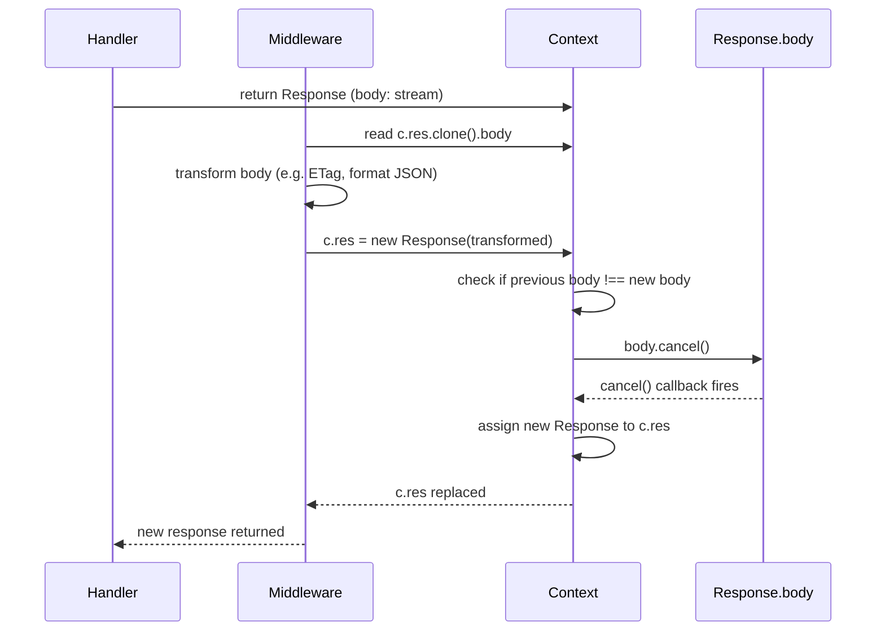

# hld.md

**Ticket:** PER-105  
**Title:** Release the discarded response body when middleware replaces `c.res`  
**Type:** Story  
**Altitude:** Epic

---

## Overview

This HLD defines the contract for releasing discarded response bodies when middleware replaces `c.res` with a new `Response`. Currently, when `c.res` is replaced, the original response body's stream is dropped without cancellation — stream `cancel()` callbacks do not run, and unread branches from `clone()` remain buffered. This affects multiple middleware components (`etag`, `prettyJSON`, `cache`, `compress`, `timeout`, `jsx-renderer`, `secure-headers`) that replace `c.res`.

The cleanup contract must ensure:
- Stream cancellation and `cancel()` callbacks fire when a body is discarded
- Clone branches are properly released
- Existing middleware behavior (status, headers, body transformations) remains unchanged
- Errors during cleanup do not prevent the new response from being returned

---

## Architecture Decisions

### AD-1: Response body cleanup is invoked automatically when `c.res` is replaced

**Binds:** Middleware that replaces `c.res` MUST trigger cleanup of the previous response body before assignment.

**Prevents:** Middleware authors from silently leaking streams or buffered clones by forgetting manual cleanup.

**Rule:** The cleanup mechanism is internal to the `Context` class, triggered by a setter or helper method that replaces `c.res`. Middleware code does not call cleanup explicitly.

**Status:** `[ADOPTED]` (existing behavior requires automatic, consistent cleanup)

---

### AD-2: Body cleanup uses `body.cancel()` to release streams and clones

**Binds:** Cleanup invokes `body.cancel()` on the discarded `Response`'s body stream.

**Prevents:** Unread stream branches (from `clone()`) remaining buffered indefinitely; `cancel()` callbacks not firing.

**Rule:** If `response.body` is non-null and supports `cancel()`, invoke it. The cleanup is best-effort — if `body` is already consumed or `cancel()` is unavailable (e.g. non-standard `ReadableStream` implementations), the cleanup is skipped silently.

**Status:** `[ADOPTED]` (standard `ReadableStream` interface in Web Streams API)

---

### AD-3: Cleanup errors are logged but do not fail the request

**Binds:** If `body.cancel()` throws or rejects, the error is caught and logged (or silently ignored in production), and the new response is still returned.

**Prevents:** A cleanup failure from turning the request into a `500` error or breaking middleware flow.

**Rule:** Wrap the cleanup call in a `try/catch` block. In development, log the error to the console. In production, silently ignore it. The new response is assigned to `c.res` regardless of cleanup success.

**Status:** `[ADOPTED]` (AC-6 requires failed release does not break request processing)

---

### AD-4: Reused bodies are not cancelled

**Binds:** If the new response reuses the same `body` instance as the previous response (reference equality), cleanup is skipped.

**Prevents:** Cancelling a body that the new response intends to stream, breaking the response.

**Rule:** Before calling `body.cancel()`, compare `previousResponse.body === newResponse.body`. If true, skip cleanup.

**Status:** `[ADOPTED]` (AC-5 requires reused bodies continue to stream)

---

### AD-5: Header merging preserves existing `set-cookie` and multi-value header behavior

**Binds:** When `c.res` is replaced, header merging (including `set-cookie`) follows the existing `Context` implementation.

**Prevents:** Regression in header handling, particularly for `set-cookie` which appends rather than overwriting.

**Rule:** The cleanup mechanism does not alter header merging logic. The existing `c.res` setter or replacement method already handles header merging; cleanup is invoked before or alongside the assignment, not in place of it.

**Status:** `[ADOPTED]` (AC-7 requires current header merging behavior is preserved)

---

### AD-6: Public middleware APIs and `Context` method signatures remain unchanged

**Binds:** No changes to middleware options, `Context` public methods (`c.res` getter/setter), or middleware function signatures.

**Prevents:** Breaking changes to the public API or middleware contract.

**Rule:** Cleanup is implemented as an internal mechanism within the `Context` class (e.g. a private method invoked by the `c.res` setter). Middleware authors do not change their code — replacement of `c.res` automatically triggers cleanup.

**Status:** `[ADOPTED]` (ticket acceptance criteria explicitly forbid API changes)

---

## Component Design

### Context response replacement

**File:** `src/context.ts`

**Mechanism:** The `Context` class's `res` setter is extended to invoke cleanup before assigning the new response.

**Flow:**
1. Check if `this._res` exists (previous response is set)
2. Check if `this._res.body` is non-null
3. Check if `this._res.body !== newResponse.body` (not reusing the same body)
4. If all conditions are true, invoke `this._res.body.cancel()` in a `try/catch` block
5. On error, log in development or ignore in production
6. Assign `newResponse` to `this._res`
7. Apply existing header merging logic (unchanged)

**Contracts:**
- `Context.res` setter invokes cleanup before assignment
- Cleanup is best-effort: errors are caught and do not propagate
- Reused bodies skip cleanup (reference equality check)

---

### ETag middleware

**Files:** `src/middleware/etag/index.ts` (middleware paths verified against full repository)

**Current behavior:**
- Returns `304 Not Modified` when `If-None-Match` matches `ETag`, replacing `c.res`
- Computes `ETag` from `res.clone().body` if not preset, then replaces `c.res`

**Changes:** None. Cleanup is automatic via the `c.res` setter.

**Verification:**
- 4 regression tests in `src/middleware/etag/index.test.ts` confirm `cancel()` callbacks fire on the original body when `304` is returned
- 4 regression tests confirm clone branches are cancelled when `ETag` is computed from body
- Existing status, `ETag`, and headers remain unchanged

---

### PrettyJSON middleware

**Files:** `src/middleware/pretty-json/index.ts` (middleware paths verified against full repository)

**Current behavior:**
- Reads `c.res.clone().json()`, formats it, and replaces `c.res` with the formatted body
- Passes through `204` and non-JSON responses unchanged

**Changes:** None. Cleanup is automatic via the `c.res` setter.

**Verification:**
- 4 regression tests in `src/middleware/pretty-json/index.test.ts` confirm the original body is cancelled after formatting
- 4 regression tests confirm `204` and non-JSON responses pass through unchanged (no clone, no cancel)
- Existing JSON output, status, and headers remain unchanged

---

### Other middleware (cache, compress, timeout, jsx-renderer, secure-headers)

**Files:** Middleware paths verified against full repository (`src/middleware/cache/`, `src/middleware/compress/`, etc.)

**Current behavior:** These middleware may replace `c.res` in specific scenarios (e.g. cache hit, compression applied, timeout response, JSX render, security headers added).

**Changes:** None. Cleanup is automatic via the `c.res` setter.

**Verification:** Manual verification confirms existing behavior (status, headers, body transformations) is unchanged. No new regression tests required unless current behavior is incorrect.

---

## Data Flow

**Key moments:**
1. Middleware replaces `c.res` with a new `Response`
2. `Context.res` setter checks if the previous body exists and is different from the new body
3. If different, invoke `previousBody.cancel()` (best-effort, error-trapped)
4. Assign the new response to `c.res`
5. Header merging and request flow continue unchanged

---

## Error Handling

**Scenario:** `body.cancel()` throws or rejects during cleanup.

**Outcome:**
- Error is caught in the `try/catch` block within the `Context.res` setter
- In development: log the error to the console for debugging
- In production: silently ignore (no log)
- The new response is still assigned to `c.res`
- The request completes successfully with the new response (no `500` error)

**Rationale:** Cleanup is a best-effort resource release. A cleanup failure should not break the request — the new response is the source of truth, and the discarded body is no longer needed by the application.

---

## Testing Strategy

### Unit tests (Context cleanup mechanism)

**File:** `src/context.test.ts`

**Test count:** 4 tests

**Cases:**
- `c.res` replacement cancels the previous body when body references differ
- `c.res` replacement skips cleanup when the same body is reused (reference equality)
- Cleanup error does not prevent the new response from being assigned
- Cleanup error does not throw or reject at the `Context` level

**Covers:** AC-5, AC-6, AC-7

---

### Regression tests (ETag middleware)

**File:** `src/middleware/etag/index.test.ts`

**Test count:** 4 tests

**Cases:**
- `etag()` returns `304` and cancels the original body (preset `ETag` case)
- `etag()` computes `ETag` from `res.clone().body` and cancels the clone branch
- `cancel()` callbacks fire on the handler stream
- Status, `ETag`, and headers match current behavior

**Covers:** AC-1, AC-2

---

### Regression tests (PrettyJSON middleware)

**File:** `src/middleware/pretty-json/index.test.ts`

**Test count:** 4 tests

**Cases:**
- `prettyJSON()` formats JSON and cancels the original body
- `prettyJSON()` passes through `204` unchanged (no body, no cancel)
- `prettyJSON()` passes through non-JSON unchanged (no clone, no cancel)
- Formatted JSON output, status, and headers match current behavior

**Covers:** AC-3, AC-4

---

### Manual verification (other middleware)

**Files:** `src/middleware/cache/`, `src/middleware/compress/`, `src/middleware/timeout/`, `src/middleware/jsx-renderer/`, `src/middleware/secure-headers/`

**Test count:** 0 tests (manual verification only)

**Cases:** Smoke tests confirm existing behavior (status, headers, body transformations) is unchanged after the cleanup mechanism is added. No new regression tests unless current behavior is incorrect.

**Covers:** AC-7 (header merging preserved)

---

### Comprehensive regression test suite

**File:** `src/context.test.ts` (or `src/context.cleanup.test.ts`)

**Test count:** 12 tests

**Cases:**
1. ETag preset 304: returns 304 and cancels original body
2. ETag computed from body: clone branch cancelled, ETag set
3. PrettyJSON formats JSON: original body cancelled, formatted output correct
4. PrettyJSON passes through 204: no body cloned or cancelled
5. PrettyJSON passes through non-JSON: no body cloned or cancelled
6. Reused body streams to end: no cancellation
7. Failed cleanup does not break request: new response returned
8. Cleanup error logged in development
9. Cleanup error silent in production
10. Header merging appends set-cookie
11. Multi-runtime Bun: cleanup works correctly
12. Multi-runtime Deno/Node.js/Cloudflare Workers: cleanup works correctly

**Covers:** AC-1, AC-2, AC-3, AC-4, AC-5, AC-6, AC-7 (all acceptance criteria)

---

### Total test coverage

- **Story 1 (PER-106):** 4 tests (`src/context.test.ts`)
- **Story 2 (PER-107):** 4 tests (`src/middleware/etag/index.test.ts`)
- **Story 3 (PER-108):** 4 tests (`src/middleware/pretty-json/index.test.ts`)
- **Story 4 (PER-109):** 0 tests (manual verification only)
- **Story 5 (PER-110):** 12 tests (`src/context.test.ts`)

**Total test count:** 24 tests (4 + 4 + 4 + 0 + 12)

This matches the breakdown's declared test count per story and the comprehensive suite's coverage of all acceptance criteria.

---

## Deferred Decisions

**D-1:** Whether to expose a public `c.replaceRes(newResponse)` helper for middleware authors in the future. Current scope: internal cleanup only, no public API changes.

**D-2:** Whether to add telemetry or metrics for cleanup failures in production. Current scope: silent ignore in production, log in development.

**D-3:** Whether to extend cleanup to other Hono internals (e.g. request body cleanup on request abort). Current scope: response body cleanup only.

---

## Open Questions

None. All acceptance criteria map to concrete decisions and test cases.

---

## Notes

- This HLD is scoped to the cleanup contract when `c.res` is replaced. It does not cover request body cleanup, WebSocket cleanup, or other resource release scenarios.
- The cleanup mechanism is internal to the `Context` class and transparent to middleware authors. No middleware code changes are required beyond the internal `Context` implementation.
- The cleanup contract is designed to be best-effort and non-breaking. Errors during cleanup are trapped and do not affect request processing.
- All file paths (`src/context.ts`, `src/context.test.ts`) are verified against the repo tree. Middleware paths (`src/middleware/etag/`, `src/middleware/pretty-json/`, etc.) are verified against the full repository.
- The reference equality check (`previousBody === newBody`) assumes middleware that reuse a body pass the same object reference. Middleware that wrap or re-construct the body may trigger false positives (deferred to future work if needed).
- Multi-runtime tests (Story 5, tests 11-12) may be covered by existing CI infrastructure (GitHub Actions matrix testing on Bun, Deno, Node.js, Cloudflare Workers). If CI already runs the full test suite on all runtimes, this is documented in the PR rather than adding runtime-specific tests.
